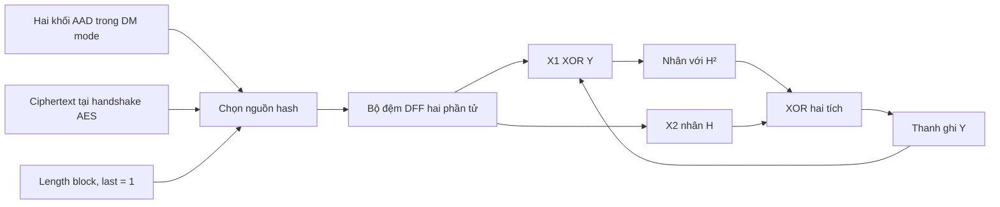

# Đọc kiến trúc GHASH x2

## 1. Đi theo luồng dữ liệu



Mã hóa lấy ciphertext ở output AES; giải mã lấy ciphertext ở input AES. Chỉ tăng `auth_bit_count` khi handshake ciphertext xảy ra. AAD và length block không tăng bộ đếm này. Hai khối AAD vẫn chứa 192 bit thực + 64 bit padding khi DM mode bật.

Các tệp nên đọc theo thứ tự:

1. `gf_mult_128.v`: phép nhân trường thuần tổ hợp.
2. `ghash_core.v`: hai phép nhân song song, setup H² và thanh ghi Y.
3. `auth_pair_buffer.v`: gom cặp, giữ dữ liệu khi downstream dừng.
4. `aes_xts_top_module.v`: FSM setup và kết nối AAD/ciphertext/finalize.

Các phép AES round giữ nguyên; S-box hiện đã được thay bằng logic tổ hợp + DFF giữ latency, xem [S-box logic](aes-sbox-logic.vi.md). FSM setup **hệ thống** nằm trong top; `aes_setup_engine.v` chỉ thực hiện các phép AES iterative được FSM gọi.

## 2. Bộ nhân không RAM

`gf_mult_128` không có clock/reset/register. Mạng polynomial-basis gồm AND tạo partial products, cây XOR cân bằng bảy tầng cộng các partial products, rồi mạng reduction tuyến tính cố định (dạng phân tích của ma trận reduction Mastrovito).

GHASH dùng bit 127 làm hệ số x⁰. Module đảo thứ tự bit bằng nối dây để vector nội bộ có `poly[i]` là hệ số xⁱ, nhân đa thức không nhớ, rồi đổi trở lại.

Đa thức modulo là `x¹²⁸ + x⁷ + x² + x + 1`. Tích thô có bậc tối đa 254, viết thành `low + x¹²⁸·high`. Thay `x¹²⁸` bằng `x⁷ + x² + x + 1`:

```
first_fold = high XOR (high << 1) XOR (high << 2) XOR (high << 7)
overflow = first_fold[133:128]
second_fold = overflow XOR (overflow << 1) XOR (overflow << 2) XOR (overflow << 7)
result = low XOR first_fold[127:0] XOR second_fold
```

Lần gấp thứ hai có bậc tối đa 12, không còn tràn. Mọi shift đều có khoảng dịch cố định lúc elaboration; không có vòng lặp theo clock hoặc bảng tra. Bảy tầng XOR của cây tích không bao gồm độ trễ reduction/routing. Đây không phải lời khẳng định timing bằng zero.

## 3. H và H² chỉ đổi khi setup khóa hash

Core có hai thanh ghi `h_reg` và `h_squared_reg`. Các sự kiện:

| Cạnh clock / điều kiện | Hành vi |
|---|---|
| `invalidate_key` | Xóa H, H², Y; bỏ readiness và hủy setup đang chờ. |
| `key_load` | Chốt H từ AES output; xóa Y; `keys_ready=0`; đặt `square_pending=1`. |
| Cạnh kế tiếp, `square_pending` | Chốt H² từ multiplier 1 đang nhận `(H,H)`; bật `keys_ready`. |
| `clear` khi đã setup | Xóa Y; giữ H và H² cho thông điệp tiếp. |
| `valid && ready` | Chốt Y mới và các cờ hoàn thành. |

Top dùng các tên trạng thái `SETUP_H_START`, `SETUP_H_WAIT`, `SETUP_H2_WAIT`, `SETUP_MASK_START`, v.v. Sau khi AES trả H, top phát `key_load`, chờ `keys_ready` mới rồi tiếp tục mask/tweak. `SETUP_H2_WAIT` không đọc readiness cũ ở cạnh vừa phát yêu cầu load.

Chỉ có **hai instance `gf_mult_128`** trong core. Multiplier 1 được mux sang H×H lúc setup; không có multiplier thứ ba. Khi chỉ đổi LBA, H/H² được giữ; khi đổi auth key hoặc mode, core bị invalidate và setup lại.

## 4. Commit một cặp hoặc một khối lẻ

| `two_blocks` | Multiplier 1 | Multiplier 2 | Y mới |
|---|---|---|---|
| 1 | `(Y XOR X1) × H²` | `X2 × H` | XOR hai tích |
| 0 | `(Y XOR X1) × H` | `0 × H` | Tích thứ nhất |

Core có thể nhận batch ở các cạnh liên tiếp sau setup. Y chốt ở cạnh trước là đầu vào phản hồi của batch kế tiếp. `done` báo mỗi batch đã commit; `last_done` chỉ báo batch có `last=1`. Hai cờ có thể cao ở các chu kỳ liên tiếp khi các batch tương ứng được nhận liên tiếp.

Trong top, `last_done` được đọc ở cạnh kế tiếp sau commit, khi accumulator đã chứa kết quả của length block. Lúc đó mới chốt `calculated_tag = Y XOR gmac_mask`.

## 5. Bộ đệm hai phần tử và backpressure

Đã bỏ `auth_fifo.v`/`auth_fifo4`; thay bằng `auth_pair_buffer.v`. Đây là bộ gom cặp có hai slot DFF và backpressure tổ hợp; **không phải** skid buffer cắt đường ready bằng register.

- Chỉ giữ một khối chưa có `last`: chờ khối thứ hai.
- Đủ hai khối: trình cả cặp cho GHASH.
- Một khối có `last`: trình batch một khối, dùng công thức lẻ.
- Khi batch bị stall: giữ nguyên valid, hai data, `two_blocks` và `pair_last`.
- Khi pop cặp và nhận input cùng cạnh: xóa cặp cũ, đặt input mới vào slot thứ nhất.
- Không nhận khối mới khi buffer còn `last`, để không ghép qua hai thông điệp.
- `clear` hủy toàn bộ dữ liệu/metadata đang đệm và chặn handshake tại cạnh đó.

Ví dụ không stall, các input mỗi chu kỳ:

| Trước cạnh | Sự kiện tại cạnh | Buffer sau cạnh |
|---|---|---|
| rỗng | nhận X1 | X1 |
| X1 | nhận X2 | X1, X2 |
| X1, X2 | GHASH lấy cặp; nhận X3 | X3 |
| X3 | nhận X4 | X3, X4 |
| X3, X4 | GHASH lấy cặp; nhận X5 | X5 |

Vì AES rộng 128 bit, một cặp xuất hiện mỗi hai chu kỳ input. Core có khả năng nhận một cặp/chu kỳ, còn toàn top nhận/trả **một khối/chu kỳ** khi không stall. Không có vòng tổ hợp valid→ready: `pair_valid` chỉ phụ thuộc thanh ghi buffer; `ghash_ready` chỉ phụ thuộc trạng thái khóa/reset/control.

Nếu cần register hóa ready để cải thiện timing, phải thiết kế lại dung lượng skid/credit cho dữ liệu đến muộn; không chỉ thêm register vào ready hiện tại.

## 6. Finalize không đợi buffer rỗng

Luồng điều khiển:

1. CSR finalize đặt `finalize_pending`, chặn input mới.
2. Cho AES drain mọi khối đã nhận; chờ hết AAD.
3. Enqueue đúng một length block với `in_last=1` khi buffer sẵn sàng. **Không chờ buffer empty.**
4. Buffer ghép khối lẻ đang chờ với length block, hoặc nhả length block đơn lẻ.
5. GHASH commit batch cuối, top lấy tag ở cạnh tiếp theo và bật `tag_ready`.

Nếu ciphertext có số khối lẻ, length block hoàn tất cặp cuối. Nếu ciphertext có số khối chẵn, length block là singleton. Thông điệp rỗng vẫn hash length block; trong DM mode vẫn có hai khối AAD trước nó. Không đệm thêm nguyên một khối zero vào GHASH.

Giữ nguyên CSR map. Khi ghi `SEC_CTRL`, phần mềm phải giữ đúng bit mode (bit 4), vì đó là thanh ghi mode chứ không chỉ thanh ghi lệnh. Cấu hình key/mode/LBA/AAD khi hệ thống rảnh; đợi datapath-ready rồi reset GHASH cho message mới. `reset_ghash` dùng ở ranh giới message, không phải lệnh hủy AES đang bay. `clear_keys` hủy valid pipeline và buffer, invalidate H/H²; đây không phải chứng minh zeroization mọi thanh ghi AES vật lý.

## 7. Kiểm chứng và giới hạn

`tests/run_checks.py` kiểm tra phép nhân bằng mô hình đa thức độc lập, recurrence GHASH tuần tự, bộ đệm qua scoreboard, XTS bằng cryptography/OpenSSL và tag bằng AES+GHASH phần mềm. Có test duy trì một khối mỗi chu kỳ ở cả input/output, test thay LBA giữ H², thay mode/key tạo H² mới, clear-key giữa pipeline và khởi động lại.

Chưa có FPGA part/clock constraint/Quartus project, nên chưa xác nhận ALM, M20K, fmax hoặc timing closure. S-box AES cũng đã chuyển sang logic tổ hợp; Yosys kiểm tra không còn inferred memory. Các vấn đề giao thức đã nêu ở [đánh giá baseline](parallel-ghash-review.vi.md), như nonce theo LBA và trả plaintext trước khi xác thực tag, không được giải quyết bởi phép thay GHASH này.
